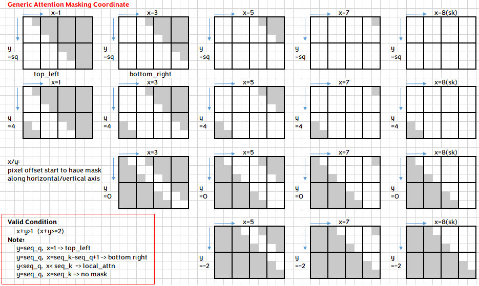

# fused multi-head attention

This folder contains example for fmha(fused multi-head attention) using ck_tile tile-programming implementation. It is a good example to demonstrate the usage of tile-programming API, as well as illustrate the new approach to construct a kernel template and instantiate it(them) while keeping compile time fast.

For a PyTorch API and the full fmha pytest
matrix using GPU references, see [the Python package](python/README.md). It
supports pip or setuptools installation and incremental kernel rebuilds. After
installation, `script/run_python_test.sh` runs the Python tests; normal pytest
arguments can be passed through to select or report cases.

## build
```
# 1. In the root of composable_kernel project, create the build directory.
[~/composable_kernel] mkdir build && cd build
# 2. In the build directory, run the CMake wrapper script to generate the build system files. Replace <arch> with the gfx architectures string.
[~/composable_kernel/build] ../script/cmake-ck-dev.sh .. <arch> -G Ninja
# 3. In the build directory, run the build system recipe.
[~/composable_kernel/build] ninja tile_example_fmha_fwd
```
Running the build recipe will produce the executable `tile_example_fmha_fwd`.

The executables reside in `bin` subdirectory of the build directory.

This example provides recipes for `tile_example_fmha_fwd`, `tile_example_fmha_bwd`.

> [!NOTE]
> `cmake-ck-dev.sh` is a CMake wrapper.
>
> The first argument is the path to composable_kernel sources.
>
> The second argument is the gfx architectures string (e.g. "gfx950" or "gfx90a;gfx942").
>
> The remaining arguments are optional and are passed through to CMake.
> E.g. `-G Ninja` specifies ninja as the build system.

## kernel
The kernel template is `fmha_fwd_kernel.hpp`, this is the grid-wise op in old ck_tile's terminology. We put it here purposely, to demonstrate one can construct a kernel by using various internal component from ck_tile. We may still have an implementation under ck_tile's include path (in the future) for the kernel template.

There are 2 template parameters for this kernel template.
* `FmhaPipeline` is one of the block_tile_pipeline(under `include/ck_tile/tile_program/block_tile_pipeline`) which is a performance critical component. Indeed, we did a lot of optimization and trials to optimize the pipeline and may still workout more performance pipeline and update into that folder. People only need to replace this pipeline type and would be able to enjoy the benefit of different performant implementations (stay tuned for updated pipeline(s)).
* `EpiloguePipeline` will modify and store out the result in the last phase. People usually will do lot of post-fusion at this stage, so we also abstract this concept. Currently we didn't do much thing at the epilogue stage but leave the room for future possible support.

## codegen
To speed up compile time, we instantiate the kernels into separate file. In this way we can benefit from parallel building from CMake/Make system. This is achieved by `generate.py` script. Besides, you can look into this script to learn how to instantiate a kernel instance step by step, which is described in `FMHA_FWD_KERNEL_BODY` variable.

### Ping-pong TDM forward pipeline

`qr_tdm_pingpong` (gfx125) is the default forward pipeline for FP16/BF16 and FP8 Q/K/V
(FP8 P; no scales, per-tensor, per-head or block descales, or MX scales) at head dims 32,
64, 96, 128, 160, 192/128, 256 and 512, at any query and key length. It stages a whole K
tile per trip in two LDS buffers: trip i reads one buffer while the TDM fills the other
with tile i + 1. On the 128-row tiles V has two buffers as well, issued a trip ahead; the
16-row (decode) tiles keep one K buffer and issue the next K once their short QK gemm has
read the current one. Two or
more resident blocks per CU overlap one block's softmax with another's gemms on the same
SIMD, the waves in their gemms at a raised priority (`s_setprio`, on the tiles that read
V before the softmax, except unmasked 128-key trips, and on MX's 128-deep PV warp gemms);
`qr_tdm_sched` instead prefetches and schedules within a block.

It has 16-, 64- and 128-row query tiles (Q/K rows of 512 bytes or more, d256 at 16 bits and
d512, have no 128-row tile), the same for every head dim and for FP16/BF16, FP8 and MX; the
tile rules are `_gfx125_qr_tdm_pingpong_tiles` in `codegen/ops/fmha_fwd.py`. A WMMA's K
slice is 32 bytes a lane at either width (32 elements at 16 bits, 64 at FP8). Q/K rows are
staged at the head dim rounded up to whole K slices (d32 is not padded to 64 at 16 bits;
FP8 d32, d96 and d160 stage 64, 128 and 192). The 16-row tiles that split their keys over
the warps take the widest WMMA K where it divides the row (32 elements at 16 bits, 128 at
FP8); FP8 d512's, whose warps share the keys, takes 64 like the other tiles.

A query takes the 16-row tile up to 16 rows, the 128-row tile from 128 rows on, and the
64-row tile otherwise, and under a sliding window of fewer than 512 keys (left + right + 1),
where the 64-row tile keeps more blocks resident against the few keys a block visits; d96,
d160, d192/128 and MX above d64 take the 128-row tile at any window (gfx1250, against the faster tile
a shape: bf16 -0.4%, fp8 -0.7%, MX -0.7% geomean).

The 16-row (decode) tile splits each trip's keys over its warps (flash decoding within the
block): `kw` warps on the keys times `4 / kw` on V's columns, each with its own online
softmax over its keys, merged through LDS after the K loop, so a trip exchanges nothing
between warps. `kw` is the most warps (4, then 2) whose shortest trip (one PV warp gemm of
32 keys at 16 bits, 64 at FP8, 128 for MX, per key warp) keeps a warp's O and V operand
within 192 VGPRs (two blocks a CU) and the trip's K and V within 128 KB of LDS. Long key
ranges take trips of up to 512 keys (64 KB of K) within the same budgets. d512 (`kw` = 1)
does not split: its four warps take 32 KB of K a trip on gemm_0's N and exchange S
through LDS.

MX (mxfp8, mxfp8bf16) takes the same tiles with the scaled WMMA (16x16x128, E8M0 scale
operands, one per 32 elements); only the gemms' K and the Q/K row differ. QK runs on the
widest WMMA K dividing the Q/K row (64-deep slices zero padded in registers), rows padded to
whole 128-deep slices only where that takes fewer WMMAs (d96 to 128, d160 and d192 to 256).
PV runs on 128-deep warp gemms, so trips take 128 keys or more, but for the prefill tiles of
d160 and d192 (`GFX125_QR_TDM_PINGPONG_MX_64_KEY_TRIPS`): their 64-key trips, on 64-deep
warp gemms zero padded in registers, keep two blocks a CU where 128-key trips keep one. d64
and below run three waves a SIMD, without the read-ahead below. An FP8 P is 256
times the softmax value (a rebase keeps it below 2^0.75, under e4m3's 448), converted
eight values at a time.

The LDS read schedule is chosen per head dim (`QrTdmPingPongLdsReadSchedule`,
`GFX125_QR_TDM_PINGPONG_LDS_READ_SCHEDULE` in `codegen/ops/fmha_fwd.py`): prefetching
the next K/V slice while the current slice's WMMAs run, and reading V's first slice
before the softmax, each from the tile size on where its VGPRs leave the occupancy
unchanged. Instance names carry `_sp<rows>` / `_vbs<rows>` for the configured parts that
take effect on their tile. Independently of that switch, the plain 128-row tiles (no
window mask, no bias, no dropout) always prefetch the next slice; their names do not show
it.

It supports masks, LSE, logits soft cap, elementwise bias and ALiBi, dropout (not on
the 16-row tile; D192/V128 takes neither dropout nor ALiBi), sink tokens, column-major V, batch and group mode, at FP16/BF16 and FP8
alike, group-mode `skip_min_seqlen_q`, and at FP16/BF16 any head dim up to the bucket's
(the padded instances store O an element at a time; FP8 and MX take head dims of whole
8-element rows); FP8 takes no scales, per-tensor,
per-head or block descales (any q block, k/v blocks of whole 32-key chunks: a PV slice
spanning blocks of several descales takes a gemm a chunk;
`_gfx125_qr_tdm_pingpong_block_scales`), or MX scales (scale rows read a word at a time
where aligned, else bytewise). It takes every forward call of its head dims but d128's small
grids at FP16/BF16 and FP8 (at least 128 query rows, fewer than two 128-row query blocks per
CU: `batch * nhead_q * max_seqlen_q < 256 * num_cus`, `GFX125_QR_TDM_SCHED_SMALL_GRID`),
where a single resident block cannot overlap softmax and gemms and `qr_tdm_sched` /
`qr_tdm_fp8_sched` run instead; it also takes the small-grid calls those refuse. MX keeps
pingpong on every grid. The forward inventories hold no `qr_tdm` or generic `qr`.

GQA decode merges the query heads of a K/V head into one tile's rows in the kernel
(`fmha_fwd_can_merge_head_groups`, batch mode, no mask or one query per head under a
bottom-right causal mask, no bias; each merged row takes its head's q descale, MX scales
and sink logit), so each K/V tile is read once per group. These packed instances (`_packgqa`, on the 16- and 64-row tiles) dispatch
ahead of the unpacked ones; folding up to 16 query rows past the 16-row tile also needs
`batch * nhead_q >= 2 * num_cus` (the `-pack_gqa` rule below).

### Basic TDM forward feature coverage

On gfx125 the forward API runs `qr_tdm_pingpong` (and the scheduled pipelines on d128's
small grids, see above); `qr_tdm` serves the split-KV/paged-KV APIs. Dropout preserves the forward/backward Philox mapping and computes LSE from the
undropped probability mass. Group skip compares the logical Q length with the
threshold and leaves skipped outputs untouched. Batch dispatch reuses `skip=false`
instances because the threshold only applies to group mode. All gfx125 receipts
accept batch `skip_min_seqlen_q=true`; custom tune `filters.skip` applies only to
group mode on this architecture.

The forward inventories contain only TDM pipelines, with head buckets up to 512.
D192/V128 generates no dropout or ALiBi; the logits soft cap with a
bias is generated for the TDM pipelines (`GFX125_TDM_PIPELINES_WITH_SOFT_CAP_BIAS`:
scale_s, the soft cap, then the bias).
FP8 and MX forward take `qr_tdm_pingpong` (see above); `qr_tdm_fp8_sched` keeps FP8 d128's
small grids. The split-KV/paged-KV APIs retain their separate inventories.

### Scheduled TDM forward pipeline

`qr_tdm_sched` shares the gfx125 TDM architecture requirements with `qr_tdm`.
On gfx125 it is generated for FP16/BF16 D128/V128 with row-major V and serves the
small-grid d128 queries `qr_tdm_pingpong` leaves to it (see above). It takes masks,
LSE, logits soft cap, elementwise bias and ALiBi, dropout and sink tokens. Its
variants without sink tokens require a null runtime `sink_ptr`; a sink logit without
sink tokens falls back to `qr_tdm_pingpong`. This runtime pointer is independent of the
compile-time sink-token flag. The pipeline also implements D64/V64 and D192/V128
geometries (described below), which are not generated on gfx125 since
`qr_tdm_pingpong` serves those head dims.

D128 uses a 128-by-128 Q/K sequence tile with padded sequence traits only (group
lengths live in device memory, so dispatch could not prove them tile aligned).
Generated scheduled sources enable expert scheduling mode.

WG indexing follows the existing shared kernel rules. For batch BHSD square
causal attention with one V tile and no dropout, sched D128 visits the longest
Q tile across heads within each batch first, subject to the grouped XCD path
described below; group mode does not enter this batch-local branch. The XCC
mode 5/tm5r experiment remains disabled unless `CK_TILE_FMHA_PAIRED_XCC_ORDER`
is explicitly defined to a nonzero value. Its eight-XCC mapping assumptions
must be checked on the target hardware before enabling it.

The forward workgroup mapping is defined in
[`fmha_fwd_workgroup_mapping.hpp`](../../../include/ck_tile/ops/fmha/kernel/fmha_fwd_workgroup_mapping.hpp).
`GetTileIndex()` normalizes the launch axes and supplies pipeline, architecture,
layout, and sequence properties to `MapFmhaFwdWorkgroup()`. That single helper
selects the path and returns the Q tile, V tile, head, and batch together.
No policy enum or intermediate permutation is exposed to callers.

The measured gfx1250 scheduled BF16 D128/M128/N128 family additionally groups
whole (batch, head) rows within each XCD for uniform, square causal MHA in
batch mode with a single V tile.
This path requires eight XCDs, 2–16 Q tiles, a batch/head product divisible by 32,
and no bias, dropout, LSE, sink, softcap, or quantization scale. Groups contain
4, 8, or 16 (batch, head) rows; heavy Q tiles run first within each group.
Larger sequences and other cases retain the existing mapping. The opt-in paired-XCC experiment,
including its fallback order, takes precedence over this grouping.

The non-causal XCD path takes group mode too when the caller sets
`fmha_fwd_args::uniform_seqlens` (the batches' query and key lengths about equal;
the Python varlen API and the example runner set it when the longest lengths are
within 1/8 of the means); otherwise group mode keeps the round-robin. The BHSD and general-grid XCD fallbacks
have the same logical head-major order. They retain separate batch-first and
tile-first arithmetic forms because merging them measured slower in the early
gfx1250 standalone experiment.
Both share the corrected Q/V decoding: masking reverses the Q dimension only.
Unit tests check the complete mapping; GPU tests exercise `GetTileIndex()`
thresholds and fallbacks. The launch interface is unchanged; `fmha_fwd_args` and the
group-mode Kargs carry the `uniform_seqlens` hint.

The mapper's coordinate coverage does not expand a pipeline's supported head
dimensions. In particular, the QR TDM paths still assume a single V tile when
loading V; testing multi-V coordinates does not establish multi-V attention
support for those pipelines.

The implementation separates tile selection, data operations, and placement:

```text
fmha_fwd.py: tile/pipeline compatibility + runtime constraints
    -> generated Problem and BlockFmhaShape
    -> FmhaTdmSchedPolicyFor<Problem>
         Geometry: dtype, tile shape, WMMA decomposition, LDS layout
         Tuning:   tensor waits, DS tail counts, compiler launch hint
         Schedule: tile phase order and local instruction placement
    -> BlockFmhaPipelineQRKSVSTdmSched<Problem, Policy>
         owns tensors, TDM loads, synchronization, and operation callbacks
    -> Schedule::Run(ops)
         Begin -> QK -> Score -> Softmax -> NextK -> PV -> Advance
    -> Policy stage operations + FmhaTdmSchedPlacementExecutor
         execute local WMMA/read/fence/rescale callbacks
```

The shared pipeline body covers all three head dimensions. Geometry derives the
number of QK/PV stages and LDS reads; default tuning derives its DS tail counts
from those values. A specific tuning can override them without duplicating the
pipeline. The LDS arena packs K0, K1, V0, and V1 in order. Q uses the K arena
during the prologue before the synchronization that permits K reuse.

The default tile schedule is `FmhaTdmSchedSequentialTileSchedule`. D64 uses
`FmhaTdmSchedReadFirstPlacement`, which issues each row's reads and fences before
its WMMA. D128/D192 use `FmhaTdmSchedWmmaFirstPlacement`, with a leading read on
selected D128 stages. Each row divides its reads into two groups around a fence.
BF16 D192/N128 uses `FmhaTdmSchedExplicitRowReadSchedule` with a concrete read
placement and streams output rescale through the first PV stage. The other
geometries use `FmhaTdmSchedEvenlyInterleavedReadSchedule`, which distributes
the fixed read count across WMMA rows. In particular, FP16 D192/N128 uses evenly
interleaved reads and rescales after softmax; it does not select the BF16
explicit placement or streaming rescale. `DeferTensorReady` moves the V prefetch
tensor wait from the score phase to after split softmax Part01 and before Part2.
It applies to D128 batch/group kernels, including masked kernels, and to BF16
D192/N64 dense batch/group kernels. LSE does not change this choice; sink-token
and bias problems are excluded. D64, FP16 D192/N64, and both D192/N128 dtypes
retain the score-phase wait. D128 rescales output before Part2; BF16 D192/N128
streams rescale through the first PV stage; the remaining geometries rescale
after Part2. Compile-time checks enforce matching geometry, stage counts, WMMA
counts, and rescale modes.

For a new placement, supply a policy's third template argument (the tile
schedule) and implement its local callbacks. The executor executes those
callbacks directly. TDM loads and hardware synchronization remain explicit
pipeline phase boundaries. Sink operations remain
for the shared kernel entry. A runtime sink logit is independent of the
compile-time sink-token flag.

`test/ck_tile/fmha` contains the scheduled pipeline's layout, schedule,
representation, sink, generated dispatch, and independent reference tests.
The independent reference retains unquantized FP32 probabilities and reports
both strict cosine diagnostics and the dtype component budget; see
[`accuracy_contract.md`](../../../test/ck_tile/fmha/accuracy_contract.md).
`test/ck_tile/tdm` retains the general TDM tests. The optional tm5r XCC ordering path remains guarded
by `CK_TILE_FMHA_PAIRED_XCC_ORDER` and is disabled when the macro is absent.

## executable
`tile_example_fmha_fwd` is the example executable, implemented in `fmha_fwd.cpp`. You can type `./bin/tile_example_fmha_fwd -?` to list all the arguments. Below is an example of the output (may subject to change)
```
args:
          -v    weather do CPU validation or not (default:1)
       -mode    kernel mode. 0:batch, 1:group (default:0)
          -b    batch size (default:2)
          -h    num of head, for q (default:8)
        -h_k    num of head, for k/v, -1 means equal to h (default:-1)
                if not equal to h, then this is GQA/MQA case
          -s    seqlen_q. if group-mode, means the average value of seqlen_q (default:3328)
                total_seqlen_q = seqlen_q * batch, and seqlen_q per batch may vary
                also with "-s=s0,s1,s2..." comma-separated ints to set per batch seqlen(group-mode)
        -s_k    seqlen_k (including new key/value), -1 means equal to s (default:-1)
                also with "-s_k=s0,s1,s2..." comma-separated ints to set seqlen per batch (group mode)
     -s_qpad    seqlen_q stride between 2 batches (group-mode optional) (default:-1)
                Provide positive strides per-batch to simulate physical padding on Q
     -s_kpad    seqlen_k stride between 2 batches, currently used in group-mode only  (default:-1)
                for kv-cache case, each batch [1,s,h,d]/[1,h,s,d] can have a stride
                along seqlen, instead of packed, same as xformer kv_padding,
                must be greater than or equal to s_k
          -d    head dim for q, k (default:128)
        -d_v    head dim for v, -1 means equal to d (default:-1)
    -scale_s    scale factor of S. 0 means equal to 1/sqrt(hdim). (default:0)
     -qscale    n or 0, no scaling (default:n)
                pt or 1, per-tensor scale
                bs or 2, block scale
                kvbs or 3, Q per-tensor, K/V per-page block scale, only in batch_prefill
                mx or 4, microscaling (mxfp8, mxfp8bf16 and mxfp4;
                           fp8 and fp8bf16 run as mxfp8 and mxfp8bf16)
                ph or 5, per-head scale
      -iperm    permute input (default:1)
                if true, will be b*h*s*d, else b*s*h*d
      -operm    permute output (default:1)
       -bias    n or 0, no bias (default:n)
                e(lementwise) or 1, elementwise bias with 1*1*s*s. e:1, 1*h*s*s. e:2, b*h*s*s
                a(libi) or 2, alibi with 1*h. a:1, b*h
       -prec    data type. fp32/fp16/bf16/fp8/fp8bf16/mxfp8/mxfp8bf16/mxfp4 (default:fp16)
       -mask    0: no mask, 1: top-left(same as 't'), 2:bottom-right(same as 'b') (default:0)
                't', top-left causal mask, 'b', bottom-r causal mask
                't:l,r', top-left sliding window attn(swa) with FA style left right size
                'b:l,r', bottom-r sliding window attn(swa) with FA style left right size
                'xt:window_size', xformer style masking from top-left, window_size negative is causal, positive is swa
                'xb:window_size', xformer style masking from bottom-r, window_size negative is causal, positive is swa
                'g:y,x', generic attention mask coordinate with y/x size (only debug purpose for now)
    -vlayout    r for row-major(seqlen*hdim), c for col-major(hdim*seqlen) (default:r)
        -lse    0 not store lse, 1 store lse (default:0)
      -kname    if set to 1 will print kernel name (default:0)
       -init    init method. ui, uniform random int, ni, normalized random int (default:uf)
                uf, uniform random float, nf, normalized random float, tf, trig float, uf:q, quantization
       -seed    random seed used for initializing input tensors. 0 for non-deterministic seed (default:11939)
  -drop_seed    seed for random number generator (default:1)
-drop_offset    offset for random number generator (default:0)
 -drop_prefs    seed and offset values are present on GPU; 0 - host, 1 - device/GPU (default:0)
 -num_splits    number of splits for key/value. 0 to determine actual number by heuristic (default:1)
     -warmup    number of iterations before benchmark the kernel (default:5)
     -repeat    number of iterations to benchmark the kernel (default:20)
       -json    0: No Json, 1: Dump Results in Json format (default:0)
   -jsonfile    json file name to dump results (default:fmha_fwd.json)
 -q_eff_lens    Batch-mode only: per-batch effective seqlen for Q (exclude PAD) (default:"")
                Comma-separated list of length 'b'. If empty, no override
-kv_eff_lens    Batch-mode only: per-batch effective seqlen for KV (exclude PAD) (default:"")
                Comma-separated list of length 'b'. If empty, no override
```
Example 1: `./bin/tile_example_fmha_fwd -b=1 -h=16 -s=16384 -d=128` will run a fmha case with batch=1, nhead=16, sequence length=16384, hdim=128, fp16 case.
Example 2: `./bin/tile_example_fmha_fwd -b=1 -h=8 -s=16384 -d=64 -drop_prefs=1 -drop_seed=10 -drop_offset=1234` will run a fmha case with
  batch=1, nhead=8, sequence length=16384, hdim=64, drop_seed=0 (in GPU memory), drop_offset=1234 (in GPU memory) fp16 case

## Padding Examples
Example 3 (Group mode with padding): `./bin/tile_example_fmha_fwd -mode=1 -b=2 -h=8 -s=1024,2048 -s_k=1024,2048 -s_qpad=1536,3072 -s_kpad=1536,3072 -d=128` will run group mode with 2 batches having different sequence lengths (1024, 2048) but physically padded to (1536, 3072) respectively.

Example 4 (Batch mode with effective lengths): `./bin/tile_example_fmha_fwd -mode=0 -b=2 -h=8 -s=2048 -s_k=2048 -d=128 -q_eff_lens=1024,1536 -kv_eff_lens=1024,1536` will run batch mode where all batches use 2048 as physical sequence length but have effective lengths of (1024, 1536) for Q and KV respectively.

## support features
Currently we are still in rapid development stage, so more features/optimizations will be coming soon.

### hdim
Currently we support `32/64/128/256` hdim for `fp16`/`bf16`, within which `64`/`128` is better optimized. hdim should be multiple of 8, while seqlen_s can be arbitrary. For hdim be arbitrary number, it can be support through padding kernel of `qr` pipeline (we didn't generate this in generate.py by default)

### group/batch mode
Currently we support both `batch mode` and `group mode` (or `varlen`, in FA's term), by setting `-mode` = `0` or `1`. In `group mode` different kind of attention mask is also supported(see below)

### MQA/GQA
By setting `-h`(nhead for q) and `-h_k`(nhead for k/v) with different number, you can achieve MQA/GQA. Please pay attention that `h % h_K == 0` when you set different numbers.

`-pack_gqa=1` (the default) folds the `h / h_k` query heads that share a K/V head into the
query length for non-causal batch-mode runs without bias or sink, so each K/V tile is
loaded once per group. On gfx125 it is skipped (with a note) for up to
16 query rows that it would fold into more than 16 rows on a grid under two (batch, head)
pairs per CU: the query would leave the 16-row decode tile for a tile with `h / h_k`
times fewer blocks.

### input/output permute, and `b*s*3*h*d`
If you look at the kernel argument inside `fmha_fwd_kernel.hpp`, we support providing arbitrary stride for seqlen(stride_q/k/v), nhead, batch of q/k/v matrix, hence it is very flexible to support `b*h*s*d` or `b*s*h*d` input/output permute. The `-iperm=0/1`, `-operm=0/1` is a convenient way to achieve this through the executable. We didn't provide a command-line arg to test `b*s*3*h*d` layout which is by default used by torch/FA, but it's trivial to achieve this if one set the proper `stride_q/k/v` value as `3*h*d`.

### attention bias
Attention bias is supported with the layout of `1*1*s*s`(similiar to input/output, different layout can be supported by changing the stride value for bias, or even extend to `b*h*s*s`) and bias value in float number.

### alibi
alibi is supported

### lse
For training kernels, "log sum exp" need to store out in forward and used in backward. We support this by setting `-lse=1`

### vlayout
We support v matrix in both row-major(`seqlen*hdim`) and col-major(`hdim*seqlen`). Since the accumulate(reduce) dimension for V is along `seqlen`, for current AMD's mfma layout which expect each thread to have contiguous register holding pixels along reduce dimension, it's easier to support col-major V layout. However, the performance of col-major is not necessarily faster than row-major, there are many factors that may affect the overall performance. We still provide the `-vlayout=r/c` here to switch/test between different layouts.

### attention mask
we support `causal mask` and `sliding window attention(swa)` mask in both batch and group mode, either from top-left or bottom-right.
Underneath, we unify the mask expression into `generic attention mask coordinate`, providing an uniformed approach for each batch to locate the corresponding pixel need to be masked out.


Since FA/xformer style with window_size_left/right is more popular, we accept window_size as parameter and convert that internally to our generic coordinate(this coordinate can express more cases). Below shows some example of how to achieve different kind of mask through cmdline.

| mask case|  cmdline    | FA style | xformer style |
|----------|:-------------:|:-------------:|:-------------:|
| no mask |  `-mask=0`(default) | | |
| causal mask from top-left | `-mask=1` or `-mask=t` | `-mask=t:-1,0` | `-mask=xt:-1` |
| causal mask from bottom-right | `-mask=2` or `-mask=b` | `-mask=b:-1,0` | `-mask=xb:-1` |
| swa from top-left | | `-mask=t:3,5` | `-mask=xt:4` |
| swa from bottom-right | |  `-mask=b:10,11` | `-mask=xb:16` |

Note FA use bottom-right by default to express swa case, here we require you explicitly specify top-left/bottom-right.

### dropout
TBD

### sequence padding and variable length support
We support sequence padding and variable-length processing in both batch and group modes fmha forward to handle real-world scenarios where sequences have different lengths.

**Group Mode Padding**: Use `-s_qpad` and `-s_kpad` to specify physical stride between batches, enabling padded layouts. Each batch can have different logical sequence lengths (`-s`, `-s_k`) but use larger physical strides for memory alignment.

**Batch Mode Variable Length**: Use `-q_eff_lens` and `-kv_eff_lens` to specify effective sequence lengths per batch. All batches share the same physical sequence length, but the kernel processes only the effective portions. This enables efficient variable-length attention without memory waste.

Both approaches optimize memory access patterns while supporting flexible sequence length requirements commonly found in transformer inference scenarios.

### kv shared
If K and V are the same tensor, pass it as both `k_ptr` and `v_ptr` with the same strides. On gfx1250 (fp16/bf16, hdim `128`/`256`, up to 16 query rows) this runs `qr_tdm_kvshared`, which loads each K/V tile once for both gemms. Use `-kv_shared=1` to test it through the executable.

## FP8 support
FP8 FMHA kernels are supported on gfx942/gfx950/gfx12/gfx1250 machines with ROCm 6.0+. Two fp8-based precision modes are available via `-prec`; on gfx942/gfx950/gfx12, `fp8` covers head dim 128 only, so use `fp8bf16` for other head dims:

| `-prec` value | Q/K/V input type | Output type | Description |
|---|---|---|---|
| `fp8` | fp8 | fp32 | fp8 inputs, fp32 output — highest-precision output, suitable for debugging or further fp32 processing |
| `fp8bf16` | fp8 | bf16 | Mixed precision: fp8 inputs, bf16 output — useful when the consumer expects a wider-range output format |

The following quantization scale modes are available via `-qscale`:

| `-qscale` value | Description |
|---|---|
| `n` or `0` | No quantization scale (default) |
| `pt` or `1` | Per-tensor quantization scale — a single scale factor is applied to the entire tensor |
| `bs` or `2` | Per-block quantization scale — a scale factor is applied per block of elements |
| `kvbs` or `3` | Q per-tensor + K/V per-page block scale (batch_prefill only) |
| `mx` or `4` | Microscaling (MX format), for `mxfp8`, `mxfp8bf16` and `mxfp4`; `fp8` and `fp8bf16` select `mxfp8` and `mxfp8bf16` |
| `ph` or `5` | Per-head quantization scale — one scale factor per (batch, head) |

Currently only `-vlayout=r` (`seqlen*hdim` for V matrix) is supported for fp8 data types.
MX data types take `-vlayout=c`, except `mxfp8`/`mxfp8bf16` on gfx1250, which need `-vlayout=r`;
`mxfp8bf16` (MXFP8 inputs, bf16 output) exists only on gfx1250.

### V scale with `bs` on gfx1250

The V scale must be a **power of two**. It rides an E8M0 scale operand and is truncated toward
zero, so `1.9` is applied as `1.0`.

Round the V scale up to a power of two **at quantization time** and quantize with that same
value. This is not checked at runtime.

## backward

`tile_example_fmha_bwd` is the training-side example, implemented in `example_fmha_bwd.cpp`.
Build it with `ninja tile_example_fmha_bwd`. Given `Q`, `K`, `V`, the forward output `O` and the
forward `LSE`, it produces `dQ`, `dK`, `dV` (and optionally `dBias`) from an incoming `dO`.

### kernels

One backward call launches two or three kernels:

| kernel | what it does |
|---|---|
| `fmha_bwd_dot_do_o` | `D[q] = rowsum(dO[q,:] * O[q,:])`, the softmax-Jacobian correction term. Also accumulates the sink gradient when enabled. |
| `fmha_bwd_dq_dk_dv` | the main loop: recompute `P = exp(S - LSE)`, then `dV = P^T dO`, `dP = dO V^T`, `dS = P * (dP - D)`, `dK = scale * dS^T Q`, `dQ = scale * dS K` |
| `fmha_bwd_convert_dq` | converts the fp32 `dq_acc` scratch to the output type |

`P` is never stored by the forward kernel. It is recomputed from `S` and the saved `LSE`, which is
exact rather than approximate: `LSE >= rowmax`, so `exp(S - LSE)` cannot overflow, and the row-max
term that online softmax subtracted in the forward pass cancels.

The third kernel exists because most pipelines split the grid along `seqlen_k`. Each block then
owns a slice of the sum that forms `dQ`, so partial results are accumulated into an fp32 `dq_acc`
workspace with `buffer_atomic_add_f32` and converted afterwards. Pipelines that keep `dQ` in
registers for the whole `K` loop (the decode pipeline, `seqlen_q <= 32`) finish `dQ` in place and
skip both the workspace and the convert kernel.

### executable

`./bin/tile_example_fmha_bwd -?` lists every argument. The shape, layout, mask, bias and dropout
arguments match `tile_example_fmha_fwd`, with these differences:

| difference | detail |
|---|---|
| `-scale` | named `-scale_s` in the forward example |
| `-dbias` | `1` also produces the bias gradient (requires elementwise bias) |
| `-p_drop` | dropout probability; the forward example has no dropout argument |
| `-deterministic` | `1` reduces `dQ` through per-block buffers instead of atomics, making the result bit-reproducible |
| `-sink_grad` | `1` computes and validates the attention-sink gradient (see below) |
| absent | `-vlayout`, `-lse`, `-qscale`, `-num_splits`, `-q_eff_lens`, `-kv_eff_lens` |

Example 1: `./bin/tile_example_fmha_bwd -b=1 -h=16 -s=4096 -d=128` runs batch mode, nhead=16,
seqlen 4096, hdim 128, fp16.

Example 2: `./bin/tile_example_fmha_bwd -mode=1 -b=2 -h=8 -h_k=2 -s=1024,2048 -d=64 -mask=1`
runs group mode with GQA (8 query heads over 2 kv heads), per-batch seqlens, and a top-left causal
mask.

### attention sink gradient

An attention sink is a learned per-head logit that joins the softmax denominator without
contributing a value vector, so the attention weights over real tokens no longer sum to one. This
is the mechanism used by gpt-oss. Setting `-sink_grad=1` gives every head a sink score and
validates its gradient:

```
P_sink[h,q] = exp(sink[h] - LSE[h,q])
d_sink[h]   = -sum_q P_sink[h,q] * D[h,q]
```

The sum runs over every query row of every batch, so `d_sink` has shape `[nhead]`.
`fmha_bwd_dot_do_o` stores one partial sum per block in the workspace, and the partials are added
in a fixed order afterwards, by `fmha_bwd_convert_dq` or, for kernel sets without it, by the last
`fmha_bwd_dot_do_o` block of each head. That makes `d_sink` bit-reproducible. The launcher takes
this path for every deterministic run, and otherwise only when the traits set `has_sink_grad` and
the kernel set has `fmha_bwd_convert_dq`; other runs accumulate with `atomicAdd`, whose result
varies in the low bits from run to run.

- **The caller must zero `d_sink_ptr` before the call.** The kernel only accumulates into it and
  never initialises it.

The `LSE` handed to the backward call must be the **post-sink** `LSE`, that is
`log(exp(LSE_nosink) + exp(sink))`, which is what the forward kernel writes when a sink is
enabled. This matters for fully masked rows: with a sink their `LSE` is `sink` rather than `-inf`,
which is what keeps `exp(sink - LSE)` finite.

A head whose sink score is `-inf` is treated as having no sink and yields a `d_sink` of exactly
zero. This is handled by skipping the head rather than by evaluating the formula, because a fully
masked row carries `LSE = -inf` as well (bottom-right causal with `seqlen_q > seqlen_k` produces
such rows) and `exp(-inf - -inf)` is `NaN`. Passing `sink_ptr = nullptr` disables the sink for the
whole call and is equivalent for a head that is `-inf` everywhere.

`D` is scaled by `p_undrop` before the sink path reads it, so dropout feeds the sink gradient
correctly.

The sink field of the mask string (`-mask=t:l,r,sink`, the StreamingLLM rolling-cache sink) is
parsed but **ignored** by the backward kernel, which always builds its mask with `sink_size = 0`.
That masking scheme is defined for inference only and has no published backward formulation.

### what the example binary can and cannot run

`CMakeLists.txt` generates the backward instances with `--receipt 3`, which is considerably
narrower than what the kernel templates support. Combinations outside it print
`no kernel found for given traits, skipping run` and are skipped, not failed:

| restriction from receipt 3 | effect |
|---|---|
| `dtype in [fp16, bf16]` | `-prec=fp32` has no instance |
| `bias in [no, alibi]` | `-bias=e` has no instance, so `-dbias=1` is unreachable |
| `deterministic == f` | `-deterministic=1` has no instance |
| `dpad == dvpad` | `-d` and `-d_v` must fall in the same padding class (both multiples of 8, or neither) |

On gfx1250 the `dq_dk_dv` pipeline follows the tile the dispatcher picks, so `-d` and `-s`
together select the tile and the tile carries the pipeline with it. Head dim buckets are
tested in ascending order, and within a bucket the first matching row wins:

| head dim | condition | tile | pipeline |
|---|---|---|---|
| `<= 32` | — | b64x128 | `TdmKRKTR` |
| `(32, 64]` | `seqlen_q <= 32` and `batch * nhead >= 768` | b32x32 | `TrLoadQRQTRDOR` + TDM policy (decode; `dQ` stays in registers) |
| `(32, 64]` | otherwise | b64x128 | `TdmKRKTR` |
| `(64, 128]` | masked, `seqlen_q <= 32` and `batch * nhead >= 768` | b32x32 | `TrLoadQRQTRDOR` + TDM policy (decode) |
| `(64, 128]` | `seqlen_q <= 32` | b32x64 | `TdmKRKTR` |
| `(64, 128]` | otherwise | b64x128 | `TdmKRKTR` |
| `(128, 256]` | — | b32x64 | `TdmKRKTR` |

The decode rows additionally require `hdim % 8 == 0`. Head dims of 32 and below, and above
128, have no decode tile, so a short `seqlen_q` there stays on `TdmKRKTR`. At head dim 128 the
b64x128 tile runs a shallower Q/dO ring up to `seqlen_q` 2048 and the deeper one beyond it.

`KRKTRVRIGLP`, `KRKTRVR` and `TrLoadKRKTRVR` are still compiled and still selected on other
architectures.

Pass `-kname=1` to print which instance was dispatched.
